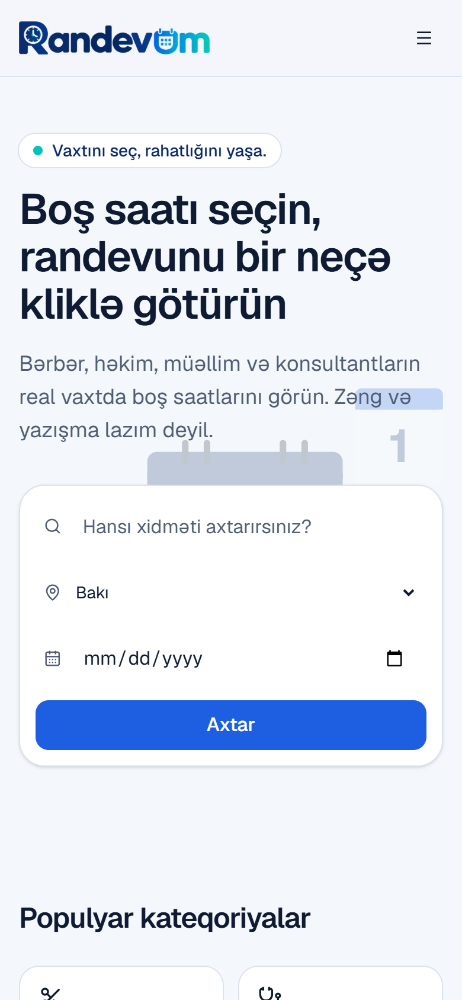
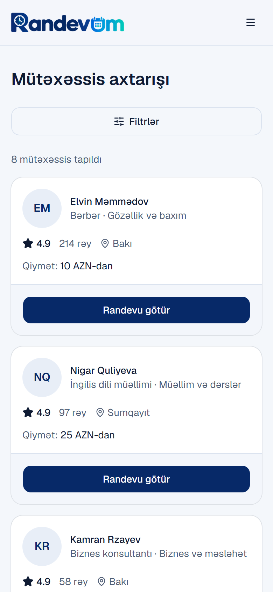
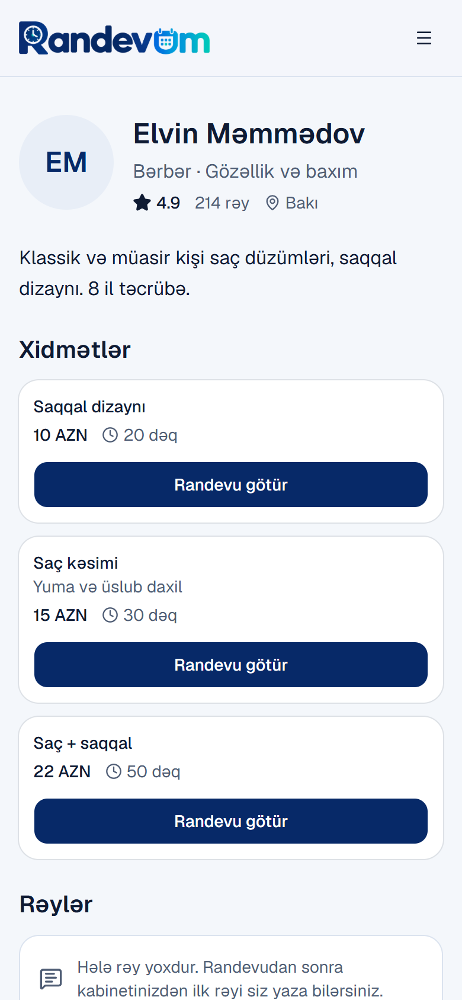
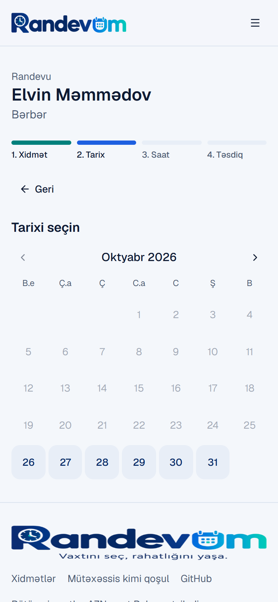
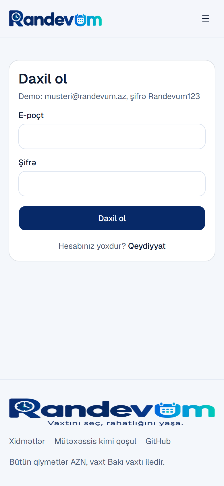

# Randevum

**Canlı sayt:** https://randevum-seven.vercel.app

Universal onlayn randevu platforması: xidmət göstərəni tap, boş saatı seç,
randevunu bir neçə kliklə götür.

- Frontend: Next.js + TypeScript + TailwindCSS + shadcn/ui (`/frontend`)
- Backend: Java 21 + Spring Boot 4 + PostgreSQL 16 (`/backend`)

Şüar: **Vaxtını seç, rahatlığını yaşa.**

Plan və həftəlik bölgü: [BACKLOG.md](./BACKLOG.md). Qaydalar: [CLAUDE.md](./CLAUDE.md).

## Arxitektura


- Brauzer API-yə birbaşa müraciət etmir: hər sorğu saytın `/api/backend` keçidindən keçir, token httpOnly cookie-dən əlavə olunur.
- Eyni vaxta iki randevu həm service qatında (Redis kilidi), həm bazada (`appointments_no_overlap` exclusion constraint) bloklanır.
- Xatırlatmalar (`reminders` cədvəli) randevuya və ya şəxsi qeydə baxır; job sətirləri `for update skip locked` ilə götürür, ona görə bir neçə instansiyada da bir dəfə göndərilir.

## Ekran şəkilləri

| Ana səhifə | Axtarış | Mütəxəssis | Randevu | Giriş |
|---|---|---|---|---|
|  |  |  |  |  |

Gecə rejimi header-dəki düymə ilə (sistem / gündüz / gecə), 360px enində mobil-first.

## API sənədi

- OpenAPI: `https://randevum-api-uu30.onrender.com/v3/api-docs`
- Swagger UI (yalnız oxuma, "Try it out" bağlıdır): `https://randevum-api-uu30.onrender.com/swagger-ui.html`
- Lokalda: `http://localhost:8080/swagger-ui.html`. Qorunan endpoint-lər üçün `POST /api/auth/login` cavabındakı `accessToken` Bearer kimi göndərilir.

## Lokal işə salma

```bash
git clone https://github.com/codelady-ship/randevum.git
cd randevum

# Frontend (http://localhost:3000)
cd frontend
npm install
npm run dev

# Backend və PostgreSQL (http://localhost:8080) - Docker lazımdır
docker compose up --build
```

## GitHub Codespaces (Docker lazım deyil)

Repo səhifəsində **Code > Codespaces > Create codespace on main**. Mühitdə Java 21, Node 22 və Docker hazırdır. PostgreSQL və Redis hər açılışda avtomatik qalxır (`postStartCommand`):

```bash
docker compose up -d postgres redis        # avtomatik; PostgreSQL :5433, Redis :6379
cd backend && ./gradlew bootRun --args="--spring.profiles.active=dev"   # API :8080, demo data ilə
cd backend && ./gradlew check              # Testcontainers testləri daxil
cd frontend && npm run dev                 # sayt :3000
```

## Layihə necə qurulub (istifadə olunan komandalar)

```bash
# Frontend
npx create-next-app@latest frontend --ts --tailwind --eslint --app --src-dir --import-alias "@/*" --use-npm
cd frontend && npx shadcn@latest init

# Backend (Spring Initializr)
curl https://start.spring.io/starter.zip -d type=gradle-project -d language=java \
  -d javaVersion=21 -d groupId=az.randevum -d artifactId=backend \
  -d dependencies=web,data-jpa,postgresql,flyway,validation,security,actuator,testcontainers -o backend.zip
```

## Demo hesablar

Bütün demo hesabların şifrəsi: `Randevum123`

| Rol | E-poçt |
|---|---|
| Admin | admin@randevum.az |
| Müştəri | musteri@randevum.az |
| Mütəxəssis | elvin-barber@randevum.az (və digər `<slug>@randevum.az`) |

## Deploy

### Frontend (Vercel)

- **Production:** https://randevum-seven.vercel.app
- Vercel layihəsi `randevum`, Root Directory: `frontend`, Node 22.
- `main`-ə hər merge avtomatik production deploy edir; hər PR öz preview linkini alır.
- **PWA:** sayt telefona quraşdırıla bilir (`src/app/manifest.ts`, `public/sw.js`, offline səhifə `/offline`). Android Chrome "Quraşdır" düyməsi göstərir; iPhone-da banner Safari-nin "Paylaş -> Ana ekrana əlavə et" addımlarını izah edir (iOS-da push yalnız quraşdırılmış PWA-da işləyir). İkonlar `public/icons`-dadır, `node scripts/pwa-icons.mjs` ilə brend işarəsindən yenidən yaradılır. Service worker API cavablarını keşləmir; `sw.js` dəyişəndə `VERSION` sabitini artırın.

### Backend (Render, Docker)

`render.yaml` Blueprint iki servis yaradır: `randevum-api` (`backend/Dockerfile`) və `randevum-redis` (Key Value). PostgreSQL 16 bazası Neon-dadır (pulsuz, silinmir, Frankfurt).

1. https://render.com - GitHub ilə daxil ol.
2. New -> Blueprint -> `codelady-ship/randevum` reposunu seç -> Apply.
3. Render -> `randevum-api` -> Environment: Neon -> Connect bölməsindən (birbaşa bağlantı, `-pooler` olmayan host):
   - `SPRING_DATASOURCE_URL` = `jdbc:postgresql://<host>/<database>?sslmode=require`
   - `SPRING_DATASOURCE_USERNAME`, `SPRING_DATASOURCE_PASSWORD`
4. Web Push üçün bir dəfə `npx web-push generate-vapid-keys` işlədin və Environment-ə `VAPID_PUBLIC_KEY`, `VAPID_PRIVATE_KEY` yazın (`VAPID_SUBJECT` `mailto:` ünvandır). Açarlar boşdursa API hər açılışda təsadüfi cüt yaradır və köhnə abunəliklər işləmir.
5. Yoxlama: `https://<servis>.onrender.com/api/health`. İlk açılışda Flyway cədvəlləri və demo datanı yaradır.

- **Production API:** https://randevum-api-uu30.onrender.com
- Vercel-də `API_URL` bu ünvana baxır; brauzer API-yə birbaşa yox, saytın `/api/backend` keçidi ilə müraciət edir.

Qeydlər: pulsuz plan 15 dəqiqə istifadəsiz qalanda yatır (ilk sorğu ~1 dəq). Neon pulsuz planında ayda 100 CU-saat var; API boş bağlantıları 2 dəqiqəyə bağlayır ki, baza yata bilsin. Backup: Neon pulsuz planda bazanı son saatların istənilən anına qaytarmağa (restore) imkan verir; daha uzun saxlama ödənişli plandadır. `backend/` xaricindəki dəyişikliklər backend deploy-unu işə salmır.

## Mobil tətbiq (Capacitor, Android və iOS)

Tətbiq production saytı native WebView-da açır (`frontend/capacitor.config.ts`, `server.url`) və native plaginlərə (lokal bildiriş, alarm) körpü ilə müraciət edir. Native layihələr `frontend/android` və `frontend/ios`-dadır; ikon və splash `node scripts/mobile-assets.mjs` ilə brend işarəsindən yaradılır.

- **Android (lokal):** Android Studio ilə `frontend/android` qovluğunu açın və ya `cd frontend && npx cap sync android && cd android && ./gradlew assembleDebug`; APK `android/app/build/outputs/apk/debug/app-debug.apk`.
- **CI:** `.github/workflows/mobile.yml` hər dəyişiklikdə Android debug APK-nı artifact kimi yükləyir və iOS-u macOS runner-də simulyator üçün build edir (imzasız). Actions -> Mobile -> Run workflow ilə əl ilə də işə salınır.
- **iOS cihaz / TestFlight:** Apple Developer hesabı tələb edir (#67); o vaxta qədər iPhone-da PWA işləyir.
- Başqa ünvana baxan build üçün: `CAPACITOR_SERVER_URL=https://... npx cap sync`.

## Təhlükəsizlik (OWASP əsas yoxlamaları)

| Risk | Necə qorunur |
|---|---|
| Broken Access Control | Hər endpoint-də rol yoxlaması (`@PreAuthorize`); mütəxəssis yalnız öz məlumatına çatır (profil tokendən tapılır), başqasının randevusu 403 qaytarır. |
| Cryptographic Failures | Şifrələr BCrypt ilə; JWT HS256, açar ən azı 32 bayt (`JWT_SECRET`); tokenlər brauzerdə yalnız httpOnly cookie-də saxlanır. |
| Injection | Bütün sorğular JPA parametrləri ilə; giriş məlumatı Bean Validation ilə yoxlanır (400 + sahə xətaları). |
| Insecure Design | Eyni vaxta iki randevu həm service qatında (Redis lock), həm bazada (exclusion constraint) bloklanır. |
| Security Misconfiguration | CORS default olaraq bağlıdır (`CORS_ALLOWED_ORIGINS`), Actuator-da yalnız `health` açıqdır, xətalar vahid ProblemDetail formatındadır (stack trace yoxdur). |
| Identification and Authentication Failures | Login: e-poçt üzrə dəqiqədə 5 cəhd; access token 15 dəq, refresh token 14 gün və rotasiya olunur, təkrar istifadə olunan refresh token istifadəçinin bütün sessiyalarını ləğv edir. |
| Rate limit | Ümumi: hər müştəri (daxil olubsa hesab, yoxsa ünvan) üzrə dəqiqədə 120 sorğu; randevu yaratma: dəqiqədə 10, gündə 20; qeyd yaratma: gündə 50; bir hesabda ən çox 20 push cihazı (429 + `Retry-After`, 422). Sorğu gövdəsi 64 KB-dan böyük olanda 413. Redis düşəndə limitlər açıq qalır (fail-open). |
| Secret scan | Hər PR-da gitleaks bütün tarixçəni yoxlayır (CI `secrets` job). Açarlar yalnız Render / Vercel / GitHub Secrets-dədir; frontend-də `NEXT_PUBLIC_*` yoxdur. |
| Loops | Xatırlatma job-u sətirləri `for update skip locked` ilə götürür və eyni tranzaksiyada `sent_at` yazır (bir cəhd, təkrar yoxdur); 404/410 push abunəliyi silinir; frontend effektlərində təkrar sorğu dövrü yoxdur. |
| Database | Neon-a yalnız API-nin bilinən istifadəçi adı/şifrəsi ilə, `sslmode=require` ilə girilir; pulsuz planda IP məhdudiyyəti yoxdur, ona görə bağlantı məlumatları yalnız Render Environment-dədir. |
| Logging | Şifrə, token və şəxsi qeydlər loglanmır; secret-lər yalnız env dəyişənlərindədir, `.env*` git-ə düşmür. |
